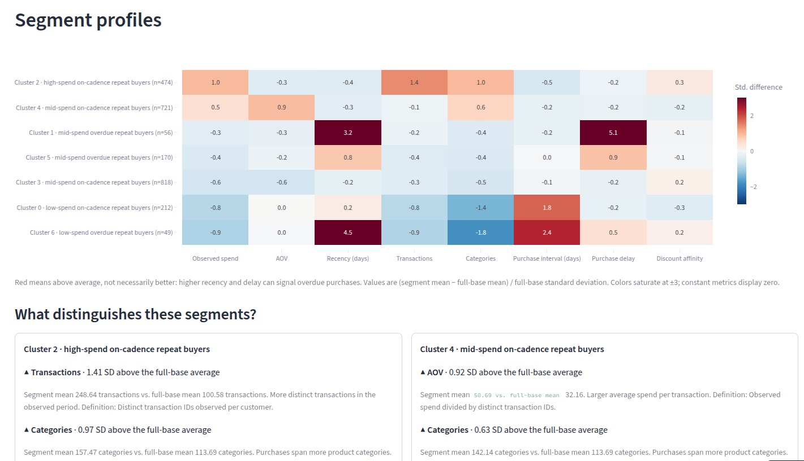

# Customer Segmentation Platform

A customer-analytics portfolio project using Polars, scikit-learn, Streamlit,
and Plotly. The app connects behavioral segmentation to business-oriented
comparisons and customer-level exploration. It is not a production-security
certification, and full browser validation with the actual datasets remains required.

## Demo

- **Live application:** <https://customer-segmentation-v1.streamlit.app/>
- **Source code:** This repository



> **To complete this section:**
> 1. Screenshot: Run `streamlit run app.py`, open in browser, capture screenshot → save as `docs/screenshots/dashboard.png`

## Architecture

```text
app.py                         Streamlit dashboard and session lifecycle
frontend_storytelling.py       Segment descriptions, contribution charts, profiles, drill-down
data_safety.py                 Shared SHA-256, session-only results, finalized retention
segmentation.py                Feature engineering, robust preprocessing, PCA, KMeans
visual.py                      Standalone visualization suite
base_scripts/                  Original EDA and feature-engineering scripts
tests/test_frontend_storytelling.py  Presentation helper tests
tests/test_data_safety.py       Fingerprint, isolation, completeness, retention tests
docs/FRONTEND_STORYTELLING.md   Frontend interpretation and validation notes
```

## Data processing pipeline

The diagram separates model training, cohort retention, and output handling.
The dashboard and offline CLI share the segmentation implementation and source
fingerprint helper, but only the offline workflow writes generated artifacts.

```mermaid
flowchart TB
    subgraph INPUT["01 | Source ingestion and identity"]
        SOURCE["Cleaned transaction Parquet<br/>Dashboard upload or local file"]
        HASH["Full SHA-256 of source bytes<br/>data_safety.source_fingerprint"]
        LOAD["Polars transaction dataset<br/>Read into memory or scan lazily"]
        MODE{"Execution mode"}
        SOURCE --> HASH --> LOAD --> MODE
    end

    CONTEXT["Dashboard session<br/>Transaction data and source fingerprint"]
    REUSE{"Matching segments and<br/>PCA metadata in this session?"}
    MODE -->|Dashboard| CONTEXT
    CONTEXT --> REUSE

    subgraph MODEL["02 | Behavioral segmentation - segmentation.py"]
        VALIDATE["Validate and clean with Polars<br/>Cast schema, normalize missing fields<br/>Filter invalid IDs, dates, prices and quantities"]
        FEATURES["Engineer customer-level features<br/>Recency, frequency and observed spend<br/>Basket, category, cadence and price behavior"]
        PREPROCESS["Robust preprocessing with Polars<br/>NaN and null handling; P99 upper capping<br/>Selected log1p transforms; median / IQR scaling"]
        PCA["NumPy boundary and scikit-learn PCA<br/>Six principal components"]
        SELECT["Select cluster count<br/>Evaluate KMeans for k = 3 to 8<br/>Minimize Davies-Bouldin index"]
        FIT["Fit final KMeans<br/>Assign each customer to a cluster"]
        RESULTS["Customer features, cluster IDs and PC1-PC6<br/>PCA variance and loadings metadata"]
        VALIDATE --> FEATURES --> PREPROCESS --> PCA --> SELECT --> FIT --> RESULTS
    end

    MODE -->|Offline CLI| VALIDATE
    REUSE -->|No match or force regeneration| VALIDATE

    subgraph RETENTION["03 | Full-base cohort retention - data_safety.py"]
        COHORTS["First observed purchase cohorts<br/>Count distinct customers by cohort and period"]
        CUTOFF["Apply finalized calendar-month cutoff<br/>Exclude latest observed month by default<br/>Allow source-confirmed completeness date"]
        MATRIX["Normalize by initial cohort size<br/>Unfinished periods remain null<br/>Finalized periods with no returns become 0%"]
        COHORTS --> CUTOFF --> MATRIX
    end
    CONTEXT -->|Loaded transactions; independent of segment filters| COHORTS

    subgraph OUTPUT["04 | Results and visual storytelling"]
        SESSION["Session-only segmentation results<br/>Segments and fingerprint-matched PCA metadata<br/>No shared result cache or generated-artifact files"]
        RETAIN["Session-only retention matrix<br/>Reuse by source fingerprint and cutoff"]
        PRESENT["Customer-level presentation<br/>Full-base benchmarks and segment descriptors<br/>Pandas conversion only for presentation"]
        DASHBOARD["Streamlit and Plotly dashboard<br/>Contribution, profiles and customer drill-down<br/>Distributions, PCA diagnostics and retention"]
        EXPORT[("Controlled offline exports<br/>customer_segments_advanced.parquet<br/>pca_metadata.json")]
        SESSION --> PRESENT --> DASHBOARD
        RETAIN --> DASHBOARD
    end

    REUSE -->|Yes; reuse current session| SESSION
    RESULTS -->|Dashboard workflow| SESSION
    RESULTS -.->|Offline CLI only| EXPORT
    MATRIX --> RETAIN

    classDef input fill:#EFF6FF,stroke:#2563EB,color:#0F172A,stroke-width:1.5px;
    classDef decision fill:#FFFBEB,stroke:#D97706,color:#0F172A,stroke-width:1.5px;
    classDef process fill:#F0FDF4,stroke:#16A34A,color:#0F172A,stroke-width:1.5px;
    classDef model fill:#F5F3FF,stroke:#7C3AED,color:#0F172A,stroke-width:1.5px;
    classDef retention fill:#ECFEFF,stroke:#0891B2,color:#0F172A,stroke-width:1.5px;
    classDef session fill:#F0FDFA,stroke:#0D9488,color:#0F172A,stroke-width:1.5px;
    classDef dashboard fill:#1E3A8A,stroke:#1E3A8A,color:#FFFFFF,stroke-width:2px;
    classDef offline fill:#F8FAFC,stroke:#64748B,color:#334155,stroke-width:1.5px,stroke-dasharray:5 5;

    class SOURCE,HASH,LOAD,CONTEXT input;
    class MODE,REUSE decision;
    class VALIDATE,FEATURES,PREPROCESS process;
    class PCA,SELECT,FIT,RESULTS model;
    class COHORTS,CUTOFF,MATRIX retention;
    class SESSION,RETAIN,PRESENT session;
    class DASHBOARD dashboard;
    class EXPORT offline;
```



- Polars handles transaction validation, feature engineering, preprocessing,
  and cohort calculations. NumPy conversion occurs at the model-fitting boundary.
- Retention uses the loaded full transaction base, not the model's validated
  transaction subset or the selected customer segments.
- Solid arrows show processing and result flow; the dashed arrow marks optional
  offline exports. Those exports are not loaded by the dashboard.
- Session isolation and source fingerprints organize results; they do not imply
  authentication, anonymization, or a security certification.

## Dashboard

- Customer share versus observed-spend share with stable full-base denominators,
  plus a spend contribution index and percentage-point gap for the leading segment.
- Behavior-derived segment descriptions retaining cluster IDs and consistent colors.
- Benchmark heatmaps with sample sizes, raw-value hover, and fixed color bounds.
- Segment differentiator cards: up to three traits per segment (at least 0.25
  full-base standard deviations), each with direction, raw segment and full-base
  averages with units, and a feature-specific interpretation based on the
  definitions in `segmentation.py`. These are descriptive, not significance tests.
- Risk-value scatterplots with point/box/lasso selection and customer-ID drill-down.
- Distributions with a Boxplot (default) / Violin plot selector, optional log axis
  (omitted non-positive values are counted; summary statistics keep them), and
  optional normalized radar profiles.
- PCA projections (PC1 vs PC2, PC1 vs PC3, 3D) with explained-variance percentages
  in axis labels when fingerprint-matched metadata is valid, labeled segment
  centers (mean PC coordinates), explained-variance chart, and signed loadings.
- On-demand monthly repeat-purchase retention with a visible finalized cutoff,
  cohort starting customer counts in row labels, and hover details (cohort, month,
  retention %, retained customers).

## Modeling scope and interpretation

The customer segmentation workflow is descriptive. Historical
spend and purchase delay are not predicted lifetime value or
calibrated churn probabilities.

The separate Purchase Inactivity tab fits an explainable
Logistic Regression baseline to estimate the probability of
no purchase in the next 30 days for currently active customers.

The model is evaluated using time-based holdout data. Treat
the resulting scores as estimates for customer ranking, not
guaranteed outcomes or validated causal explanations.

## Data identity and deployment behavior

Upload, local-file, and standalone workflows call the same full-length SHA-256
helper on source file bytes. Different Parquet encodings can have different
fingerprints even if their logical rows match. Legacy 16-character fingerprints
are not silently treated as equivalent; regenerate old artifacts when needed.

The dashboard keeps transaction data, segment assignments, PCA metadata, and
retention results (including cohort sizes) in session state. It does not read or
write generated segment or metadata files and does not place these results in a
shared Streamlit cache. Refreshing reuses only matching results within that
session; force regeneration recomputes only that session. Disconnecting/reloading
can lose session results.

`python segmentation.py` remains a controlled offline workflow that writes
`customer_segments_advanced.parquet` and `pca_metadata.json` with a full source
fingerprint. Those files are not consumed by the web dashboard. Do not run that
writer as a multi-user upload persistence service.

Session isolation does not supply authentication, encryption, a retention-policy
implementation, or a compliance guarantee. Use synthetic/anonymized demo data
for a public portfolio; do not advertise unrestricted sensitive-data uploads.

## Finalized retention

By default, the latest observed calendar month is excluded, even if the last
transaction falls on month-end. Earlier months are assumed complete. When source
completeness is known, enable the confirmed data-complete-through date. Only
whole calendar months ending on or before that date are finalized.

Unfinished periods are null (blank cells); observed periods with no returning
customers are 0%. Cohorts after the cutoff are excluded. Row labels show each
cohort's starting count of distinct customer IDs from the full base, independent
of segment filters. Month 1/3 summaries average eligible cohorts equally and
exclude nulls. The last transaction date alone cannot prove source completeness.

## Run

Python 3.10+ is required. Install dependencies, then launch:

```bash
pip install -r requirements.txt
streamlit run app.py
```

Upload cleaned transaction Parquet and click Generate segments. Alternatively,
place `customer_transactions_clean.parquet` locally as a controlled demo source.
The segmentation algorithm remains Polars feature engineering, winsorization,
log transforms, robust scaling, PCA, and KMeans with Davies-Bouldin selection.

## Validate

```bash
python -m unittest discover -s tests -v
```

Polars integration tests run when Polars is installed; otherwise they are
explicitly skipped. Session tests use a fake pipeline and do not prove browser
or model runtime behavior. Before deployment, test two independent sessions,
upload/force/switch-dataset flows, chart selection IDs, PCA metadata, and partial
versus source-confirmed complete-month retention using the actual app.

## License

MIT License; retain the repository's licensing terms.
